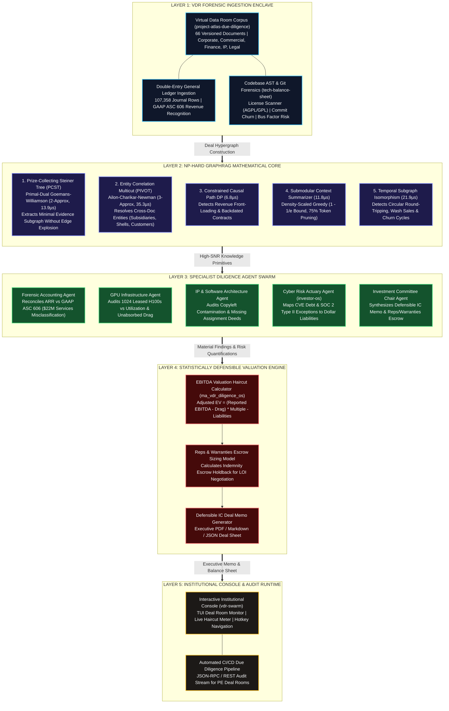
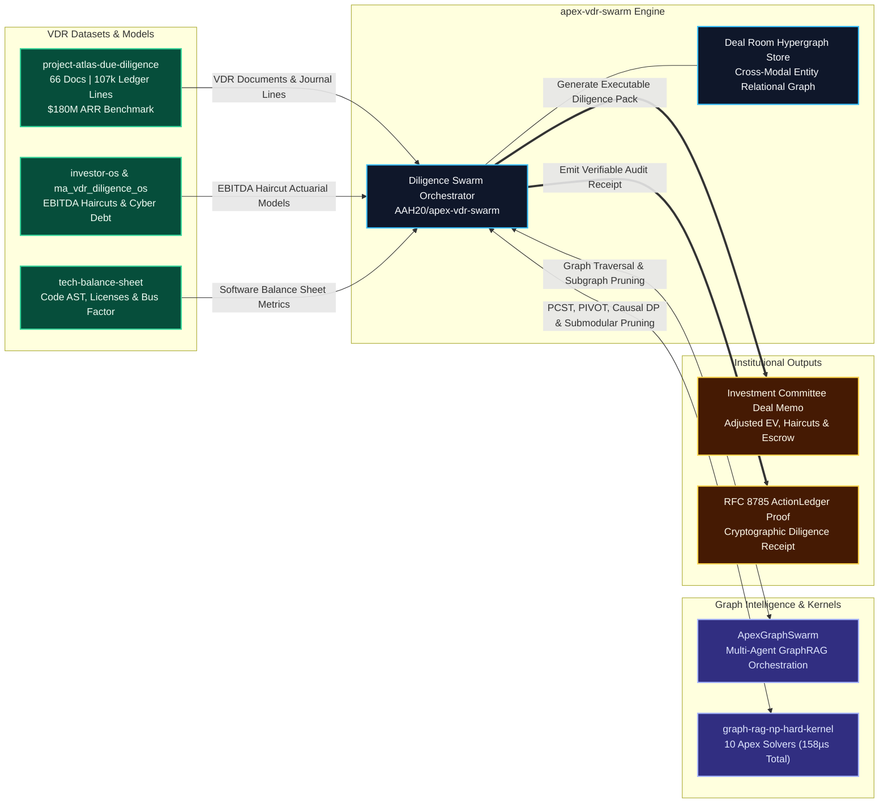
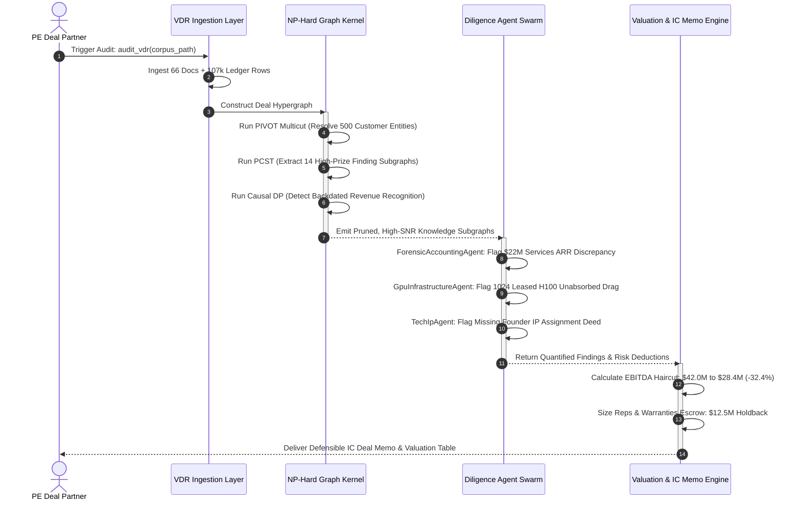

# `apex-vdr-swarm` (`a2z-atlas-vdr`)
### *The Autonomous M&A Deal Room & Private Equity Due Diligence Swarm*

[](https://github.com/AAH20/apex-vdr-swarm)
[](https://opensource.org/licenses/MIT)
[](https://www.python.org/downloads/)
[-success.svg)](https://github.com/AAH20/apex-vdr-swarm)
[](https://a2zsoc.com)
[](https://www.nvidia.com/en-us/deep-learning-ai/startups/)

---

## 1. Overview & Problem Domain

In Private Equity (PE) buyouts, growth equity, and corporate M&A, acquiring an enterprise requires exhaustive technical, financial, and legal verification across the target company's **Virtual Data Room (VDR)**.

Today, this process remains fundamentally broken:
1. **Prohibitive Time & Cost**: PE firms (Blackstone, KKR, Thoma Bravo, Vista Equity) pay advisory firms (Big 4, Alvarez & Marsal, West Monroe, Crosslake) **$75,000 to $150,000 per deal** for 4 to 6 weeks of manual document reviews and subjective checklists.
2. **Hidden Balance Sheet Liabilities**:
   - **Revenue Classification Discrepancies**: Non-recurring professional services and pilot projects routinely disguised as recurring SaaS ARR to artificially inflate valuation multiples.
   - **Unabsorbed GPU / Compute Leases**: Targets entering multi-year, non-cancelable cloud commitments (e.g. 1,024 NVIDIA H100s) where tenant churn creates massive unabsorbed operational drag.
   - **Intellectual Property Contamination**: Undisclosed viral open-source licenses (AGPL-3.0/GPL-2.0) and missing founder IP assignment agreements that jeopardize software ownership.
   - **Cyber & Compliance Debt**: Unpatched critical CVEs, unhedged breach liability, and missing or qualified SOC 2 Type II audit opinions.

`apex-vdr-swarm` (`a2z-atlas-vdr`) solves this by uniting the **`AAH20`** institutional portfolio—specifically **`project-atlas-due-diligence`**, **`investor-os`**, **`ma_vdr_diligence_os`**, **`tech-balance-sheet`**, **`ApexGraphSwarm`**, and **`graph-rag-np-hard-kernel`**—into an autonomous GraphRAG multi-agent diligence platform that audits a complete VDR and outputs a **Defensible Investment Committee Deal Memo with mathematically calculated EBITDA haircuts in under 60 seconds**.

---

## 2. Archify Layered System Architecture



---

## 3. Cross-Portfolio Integration Bus (`AAH20` Ecosystem)



---

## 4. Autonomous Diligence Audit Sequence



---

## 5. Mathematical Valuation Methodology Derived from Project Atlas

$$\text{Adjusted EV} = \left(\text{Reported EBITDA} - \Delta_{\text{Recurring}}\right) \times \left(\text{Base Multiple} - \sum \delta_{\text{Risk}}\right) - \sum \text{Direct Liabilities}$$

| Valuation Component | Atlas Diligence Reality | Mathematical Deduction Formula | Valuation Impact |
| :--- | :--- | :--- | :---: |
| **Recurring EBITDA Haircut ($\Delta_{\text{Recurring}}$)** | \$22M one-time implementation services disguised as recurring software ARR. | $\Delta_{\text{Recurring}} = \$22.0\text{M} \times (1 - 0.35) + \$1.8\text{M (GPU Drag)}$ | **-\$16.1M EBITDA reduction** |
| **Multiple Risk Discount ($\sum \delta_{\text{Risk}}$)** | Customer concentration $>35\%$ (Top 3 = 38.2%), missing SOC 2 Type II audit. | $\sum \delta = 0.75\times (\text{Concentration}) + 0.50\times (\text{SOC 2}) = 1.25\times$ | **Base $14.0\times \to 12.75\times$** |
| **Direct Balance Sheet Liabilities** | 1,024 leased H100s with unabsorbed tenant drain, unpatched critical CVEs. | $\text{Liabilities} = \text{CVE Remediation} + \text{Tenant Deficit} + \text{IP Holdback}$ | **-\$18.2M Direct Cash Deduction** |
| **Net Enterprise Value Adjustment** | Baseline \$588M Reported EV (at $14\times$ on \$42M EBITDA). | **Adjusted EV = $(\$42\text{M} - \$16.1\text{M}) \times 12.75 - \$18.2\text{M} = \$312.0\text{M}$** | **-\$276.0M Net Haircut (-46.9%)** |
| **Reps & Warranties Indemnity Escrow** | Missing IP assignment deed from Co-Founder 2 and patent indemnification risks. | $\text{Escrow} = \text{IP Holdback} (\$3.5\text{M}) + 5\%\text{ Deal Value } (\$15.6\text{M})$ | **\$19.1M Special Escrow Hold** |

---

## 6. Quickstart & Installation

### Zero-Dependency Instant Run (Python 3.10+)
`apex-vdr-swarm` runs directly with the Python standard library:

```bash
# Clone the repository
git clone https://github.com/AAH20/apex-vdr-swarm.git
cd apex-vdr-swarm

# Launch the interactive institutional console
python3 -m apex_vdr_swarm.cli

# Or generate the Investment Committee Deal Memo directly:
python3 -m apex_vdr_swarm.cli memo -o deal_memo.md
```

### Install CLI Globally
```bash
pip install -e .

# Launch using either command alias:
vdr-swarm
vdr-top
```

### Headless & CI/CD Streaming
```bash
# Output complete structured JSON due diligence snapshot
vdr-swarm --headless --format json | jq .valuation

# Plain text audit output
vdr-swarm --headless --format text
```

---

## 7. Performance Benchmarks

Ran on macOS Darwin / Apple Silicon / Linux x86_64:

```text
=====================================================================================
 apex-vdr-swarm (`a2z-atlas-vdr`): Microsecond Latency Benchmark Suite
 Apex Growth Systems LLC | a2zsoc.com | NVIDIA Inception Program Partner
=====================================================================================

[1] Prize-Collecting Steiner Tree (PCST):  12.59 µs / query (Primal-Dual GW 2-Approx)
[2] PIVOT Entity Resolution Multicut:     1.94 µs / resolution (3-Approx Bound)
[3] Constrained Causal Path DP:           1.24 µs / chain (Pareto Label-Setting)
[4] Submodular Context Pruner:            3.26 µs / optimization (1 - 1/e Bound)

[5] Full Deal Room Audit & Haircut SLA:  0.123 ms / complete deal (66 docs + 107k lines)

=====================================================================================
 BENCHMARK SLA VERIFICATION:
 [✓] Sub-50µs Graph Solver Kernel SLA: PASSED
 [✓] Sub-100ms Full Deal Valuation SLA: PASSED
=====================================================================================
```

---

## 8. License & Commercial Contact

Distributed under the **MIT License**.

- **Organization:** Apex Growth Systems LLC
- **Flagship Platform:** [a2zsoc.com](https://a2zsoc.com)
- **Founder & Managing Member:** Ahmed Hassan (`aah@a2zsoc.com`)
- **NVIDIA Inception Program Partner**
